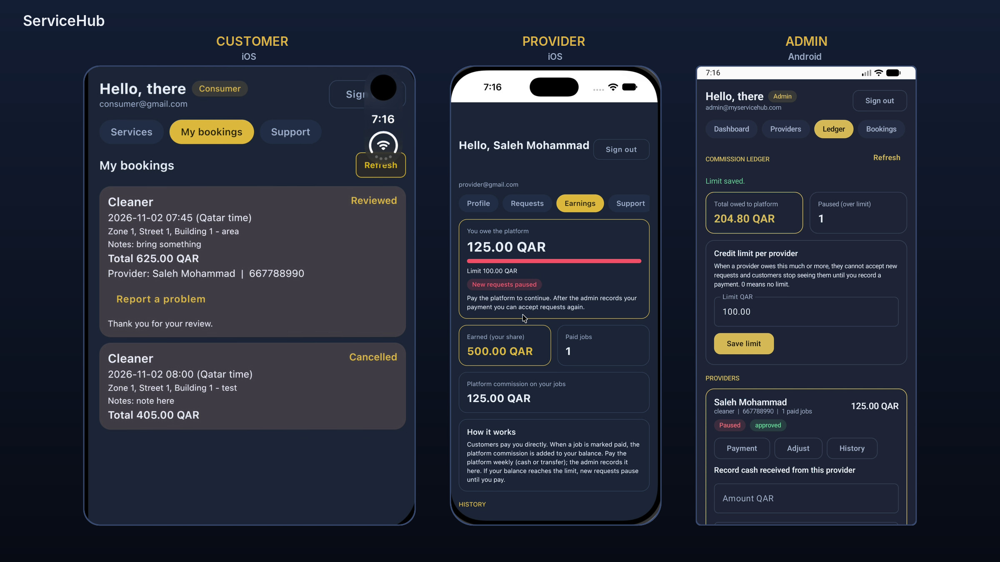
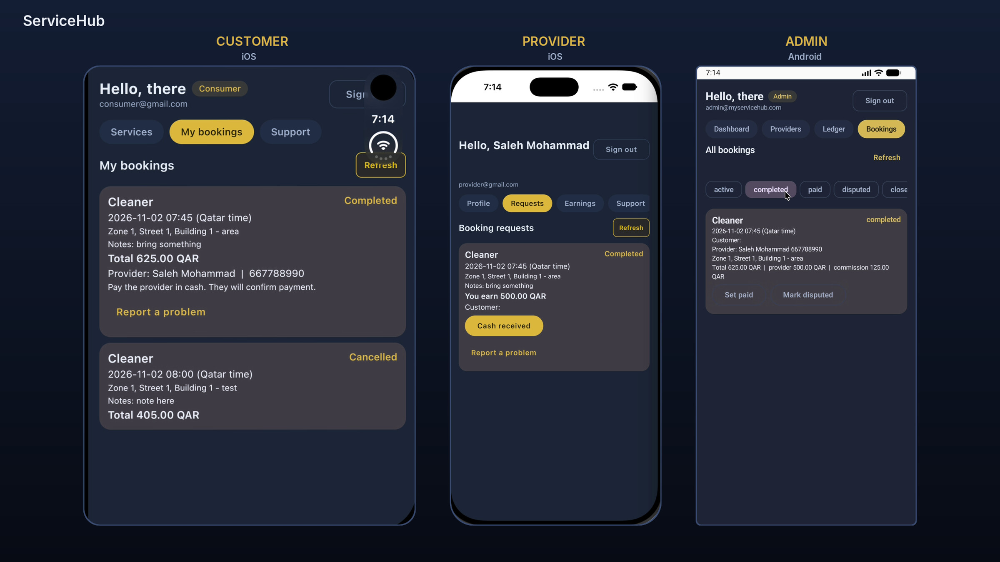
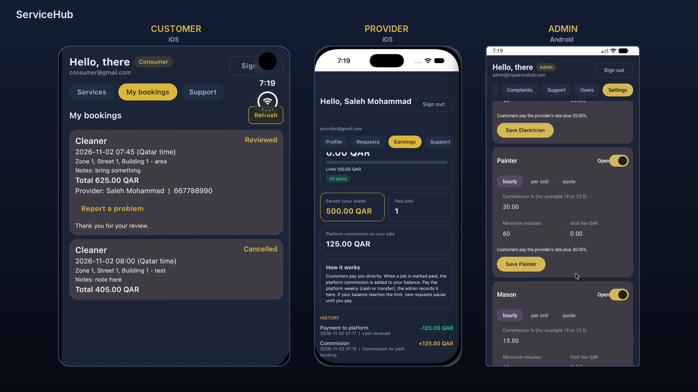
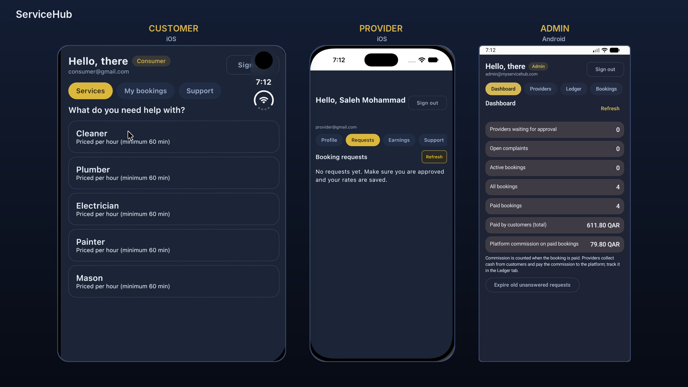

# ServiceHub

A services marketplace for non-technical, hourly trades (plumber, electrician, cleaner, painter, mason),
built with **Kotlin Multiplatform + Compose Multiplatform** and **Supabase** (Postgres, Auth, Row Level Security).
First market: **Qatar** (currency QAR). Android first, iOS later from the same code.

> Status: private pilot. Not a public product yet.

## Screenshots

Customer (iOS), provider (iOS) and admin (Android) running from the same shared code.






## Roles

| Role | What they can do |
|---|---|
| Customer | Browse a trade, pick a provider, book by the hour, track the booking, pay the provider directly, review, report a problem |
| Provider | Works in **one trade**, sets own rate, accepts or declines requests, sees earnings and the commission balance |
| Admin | Approves providers, sets categories and commission, sees all bookings, resolves complaints and tickets, blocks users, records provider commission payments |

## How money works

- The provider sets their own rate. The customer sees **rate + platform commission** (admin sets the percentage per category).
- The customer pays the provider directly. When a job is marked *paid*, the commission is added to the provider's **ledger balance**.
- The provider pays the platform (weekly). The admin records the payment.
- When a provider's balance reaches the **credit limit** (default 100 QAR, admin can change it), they cannot accept new requests and are hidden from customers until they pay.
- Money is stored in minor units (QAR has 2 decimals). Commission is in basis points (1500 = 15%).

## Architecture

```
shared/                      Kotlin Multiplatform module (Compose UI + data layer)
  commonMain/kotlin/com/servicehub/
    data/                    Supabase repositories and DTOs
    model/                   Money, time formatting, friendly error messages
    booking/                 Booking state machine (mirrored in SQL)
    ui/                      Screens (customer, provider, admin)
    ui/theme/                Brand colours, typography, shapes
    ui/components/           Reusable cards, tabs, pills
supabase/                    SQL migrations 01..09, run in order in the Supabase SQL editor
```

Security principles:

- Every table has Row Level Security. The app can only **read**; every write goes through a
  `security definer` function that checks the caller's role on the server.
- Roles come from the `profiles` table, never from user metadata.
- Booking prices are snapshotted when the booking is created.
- Every admin change is written to `admin_audit`.
- Only the publishable (anon) key lives in the app. The secret / service_role key must never be in this repo.

## Getting started

1. Create a Supabase project. In the SQL editor run `supabase/01` to `supabase/09` in order
   (use `04_make_admin.sql` with your own email after your first sign-up).
2. Copy `docs/AppConfig.example.kt` to `shared/src/commonMain/kotlin/com/servicehub/data/AppConfig.kt`
   and fill in your Project URL and **publishable** key.
3. Open the project in Android Studio and run the Android target on a fresh install.

To keep your real keys out of Git after you cloned the repo:

```
git update-index --skip-worktree shared/src/commonMain/kotlin/com/servicehub/data/AppConfig.kt
```

## Roadmap

- [x] Auth, roles, catalog
- [x] Provider profile and rates
- [x] Bookings and state machine
- [x] Admin tools, complaints, support, audit log
- [x] Commission ledger, credit limit, one trade per provider, new theme
- [ ] Date/time picker, Arabic + English (RTL), forgot password, account deletion
- [ ] ID / selfie upload and verification
- [ ] Push notifications
- [ ] Online payments
- [ ] Release: privacy policy, terms, Play Console closed test

## Legal note

Operating this publicly in Qatar needs the proper commercial registration and e-commerce licence.
This repository is the software only.

## License

Not chosen yet. Until a licence file is added, all rights are reserved by the author.
